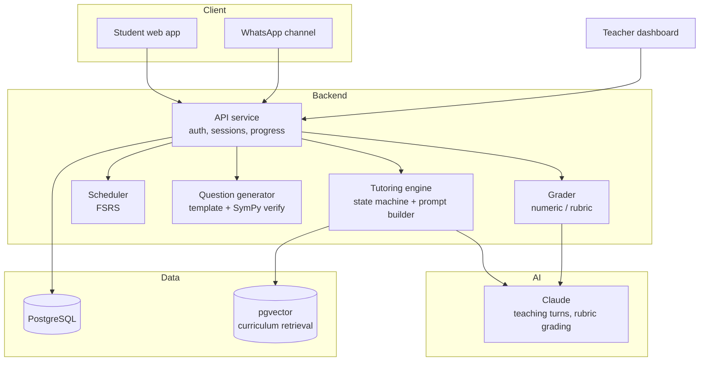

# AI Tutor — adaptive tutoring for Pakistani students

> A tutoring system that behaves like a good teacher: it diagnoses what the
> student actually misunderstands, teaches one step at a time, makes the student
> produce the reasoning, and brings the concept back at the right moment instead
> of the same moment every day.

**Status:** design specification and implementation roadmap. See
[docs/roadmap.md](docs/roadmap.md). No student data is used in this repository;
demos use synthetic profiles.

---

## The problem this solves

Most "AI tutors" are a chat box with a textbook inside. The student asks a
question, gets a long explanation, feels productive, and remembers nothing. Two
things are missing:

1. **Diagnosis.** The system does not know which prerequisite the student is
   missing, so it explains at the wrong level.
2. **Retrieval.** Learning happens on recall, but chat-based study never brings
   the material back at a spaced interval.

This system is built around those two, with the chat as one surface among several.

---

## Design principles

- **The student does the talking.** A first response should be a question, not an
  answer. The tutor's job is to make the student reason, not to perform knowledge.
- **One concept at a time.** No multi-paragraph explanations before checking
  understanding.
- **Bilingual by design.** Urdu, Roman Urdu and English are first-class; a student
  can switch mid-sentence and the tutor responds in the language they used.
- **Curriculum-bound.** Content is anchored to the Pakistani board/Cambridge
  syllabus the student selected (Matric/FSc, O/A level), not to whatever the model
  remembers.
- **Teacher-visible.** A human teacher sees what the class misunderstands; the AI
  does not replace them.
- **Honest about limits.** The tutor refuses to do graded homework for the
  student; it explains the method and asks them to complete the step.

---

## Modules

### 1. Diagnostic assessment
- Short adaptive placement (10–20 questions) per topic, choosing the next
  question by estimated mastery, not by fixed sequence
- Item bank tagged with concept, difficulty, prerequisite concept
- Produces a mastery map, not a single score: "you can solve linear equations,
  but you are guessing at rearranging the subject because exponent rules are weak"
- Prerequisite graph drives the recommendation, so the tutor teaches the missing
  foundation rather than the current lesson

### 2. Tutoring loop (Socratic)
- Turns: `probe → hint → check → refine → practice`
- Hint ladder: nudge → narrow → show a worked example on a *different* problem →
  explain fully. Each level is used only if the previous one failed.
- Structured state per session: current concept, misconception hypothesis,
  hints used, worked examples seen
- Scratchpad with working; the tutor reads the working, not only the final answer
- Step-level feedback on maths, using a symbolic checker (SymPy) rather than the
  model's arithmetic

### 3. Spaced repetition
- FSRS-style scheduler per concept and per item
- Reviews are short, mixed with new material, and scheduled by predicted recall
  probability, not by a fixed calendar
- Failure on a review re-enters the concept at the prerequisite level
- Daily plan generated as "10 minutes review, 20 minutes new, 10 minutes practice"

### 4. Practice and assessment
- Question generator constrained by a concept template, verified by the symbolic
  checker before being shown
- Multiple formats: numeric answer, steps, MCQ, "explain it back"
- "Explain it back" is graded against a rubric of required ideas, not exact wording
- Mock-paper mode with a timer and no hints, then a review of every mistake

### 5. Bilingual content layer
- Every concept has an English and a Urdu/Roman Urdu version; the tutor mixes
  registers the way real teachers do
- Terminology glossary keeps translations consistent (e.g. "derivative" is always
  the same term)
- Voice mode (optional): speech-to-text for spoken reasoning, text-to-speech reply

### 6. Teacher dashboard
- Class mastery heatmap by concept
- Misconception clusters: "14 students make the same sign error when moving terms"
- Assign a concept or a paper to a group; see completion and re-attempts
- Flag a student for a human conversation — with the evidence, not a vibe

### 7. Parent report
- Weekly WhatsApp summary: minutes studied, concepts strengthened, concepts due
  for review, one concrete suggestion
- No grades invented, no comparisons between children, no anxiety metrics

---

## Architecture

**Key decisions**

- **Retrieval over recall.** Curriculum content is chunked and embedded; every
  teaching turn cites the concept it is teaching, and the model answers from that
  chunk, not from general memory.
- **The model is a teacher, not a calculator.** Arithmetic and algebra are checked
  by SymPy. If the model's step disagrees with the checker, the checker wins and
  the tutor re-explains.
- **Session state is explicit**, stored as JSON: concept, misconception
  hypothesis, hint level, items in flight. Prompts are built from this state, so
  the tutor is consistent across turns and resumable across devices.
- **The question bank is generated offline and verified before use**, not at the
  moment a student asks. Every generated item is checked: does it have a solution,
  is it unique, is it within difficulty bounds.
- **WhatsApp as a first-class channel** because that is where students already are;
  the same session state drives both web and chat.

---

## Tech stack

| Layer | Choice | Why |
|---|---|---|
| Frontend | Next.js + TypeScript | Fast, SEO-able, works on low-end Android |
| Backend | Node.js + TypeScript | Shared types, simple deploy |
| Database | PostgreSQL + pgvector | One store for progress and retrieval |
| AI | Claude (tool use + structured output) | Teaching turns, rubric grading |
| Maths | SymPy (Python sidecar or WASM) | Deterministic checking of every step |
| Scheduler | FSRS implementation in-app | Recall-probability scheduling |
| Channels | Web + WhatsApp Business API | Meet students where they are |
| Voice (optional) | Web Speech / STT + TTS | Spoken reasoning practice |

---

## Learning design notes

- **Desirable difficulty:** don't make it too easy. Practice should be at ~70–80%
  success, and hints should cost something (they lower the mastery credit for the
  item, and the student can see this).
- **Interleaving:** mix concepts in review sessions rather than blocking one topic
  for an hour.
- **Feedback timing:** immediate for wrong steps, delayed summary for correct
  ones — so the student checks their own reasoning instead of pattern-matching
  praise.
- **No streak shaming:** the app does not punish a missed day. It adjusts the
  schedule.
- **Academic integrity:** a "homework helper" mode that refuses to produce a
  final answer to a graded question and instead teaches the method.

---

## Roadmap summary

| Phase | Scope | Exit criteria |
|---|---|---|
| 0 | Auth, student profile, curriculum model, concept graph | A student can pick a board and a topic |
| 1 | Diagnostic + mastery map | Placement produces a prerequisite-aware map |
| 2 | Socratic tutoring with hint ladder | A session follows the state machine; one concept at a time |
| 3 | Symbolic checking + practice items | Wrong steps are caught deterministically |
| 4 | FSRS scheduler + daily plan | Reviews return at the right time; plan is generated |
| 5 | Bilingual layer | A concept can be taught in all three registers |
| 6 | Teacher dashboard | A teacher sees misconceptions by class |
| 7 | WhatsApp channel + parent report | A full week can be run from WhatsApp alone |

Detail, acceptance tests and non-goals in [docs/roadmap.md](docs/roadmap.md).

---

## License

MIT — see [LICENSE](LICENSE).
